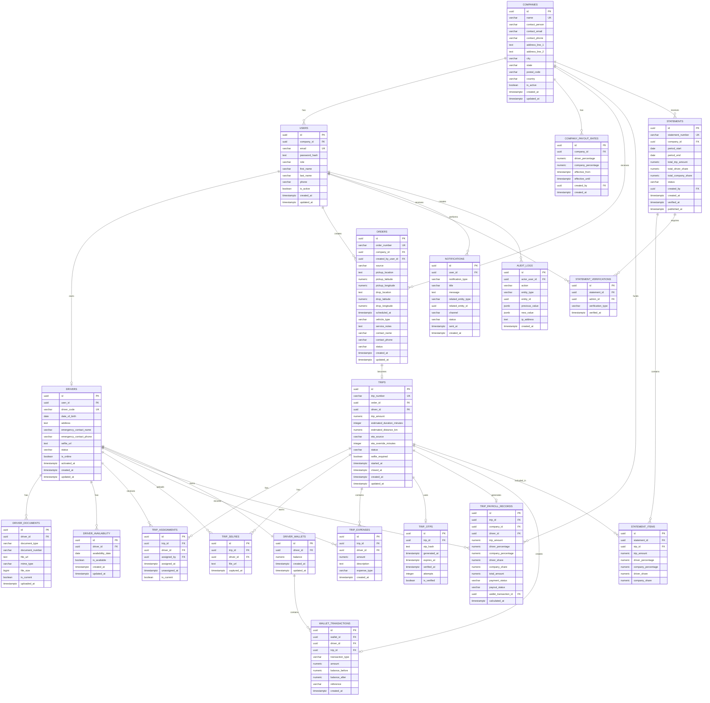

# HireD – PostgreSQL Database Design

> **Project:** HireD – Phase 1 MVP  
> **Database:** PostgreSQL  
> **Architecture:** Modular Monolith  
> **Recommended location:** `docs/database.md`

## 1. Purpose

This document defines the PostgreSQL database design for the HireD Phase 1 MVP. It is based on the HireD PRD and Buildathon Technical Guidelines.

The database supports the complete workflow:

`B2B Order → Admin Accept/Reject → Trip → Driver Assignment → Trip Start → Expenses → OTP Trip Close → Trip Report → Driver Payout → Month-End Statement → Two-Person Verification → B2B Partner Access`

The Technical Guidelines require the database documentation to cover entities, tables, columns, data types, primary keys, foreign keys, relationships, constraints, cardinality, indexes, normalization, ER diagram and important design decisions.

---

## 2. Requirements Mapped to the Database

| Requirement | Database support |
|---|---|
| B2B companies | `companies` |
| Partner login and company isolation | `users.company_id` |
| Admin / Partner / Driver roles | `users.role` |
| B2B/Admin order creation | `orders` |
| Order acceptance/rejection | `orders.status` |
| Accepted order becomes trip | `trips.order_id` |
| Driver onboarding | `drivers`, `driver_documents` |
| Driver availability | `driver_availability` |
| Driver assignment/reassignment | `trip_assignments` |
| Selfie | `trip_selfies` |
| Trip expenses | `trip_expenses` |
| Trip-close OTP | `trip_otps` |
| Company payout split | `company_payout_rates` |
| Historical payout rate | `trip_payroll_records` |
| Automatic driver payout | `trip_payroll_records`, `wallet_transactions` |
| Driver wallet | `driver_wallets` |
| Month-end statement | `statements`, `statement_items` |
| Two-person verification | `statement_verifications` |
| Notifications | `notifications` |
| Required audit trail | `audit_logs` |

---

# 3. PostgreSQL Design Decisions

## 3.1 Database

PostgreSQL is selected because it is explicitly an acceptable SQL database in the Technical Guidelines and provides the relational integrity and transaction support required by HireD.

## 3.2 Primary keys

All tables use UUID primary keys.

Benefits:

- Globally unique identifiers
- Suitable for distributed/API-driven applications
- IDs do not expose sequential record counts
- Consistent ID strategy across modules

## 3.3 Naming

Database tables and columns use `snake_case`:

```text
companies
driver_documents
trip_payroll_records
wallet_transactions
company_id
created_at
```

## 3.4 Financial types

Money uses:

```sql
NUMERIC(12,2)
```

Percentages use:

```sql
NUMERIC(5,2)
```

Floating-point types are not used for financial calculations.

## 3.5 Time

Operational timestamps use:

```sql
TIMESTAMPTZ
```

Calendar availability and statement periods use:

```sql
DATE
```

---

# 4. Tables

## 4.1 users

Authentication and application identity.

| Column | Type | Key/Rule |
|---|---|---|
| `id` | UUID | PK |
| `company_id` | UUID | FK → companies.id, nullable |
| `email` | VARCHAR(255) | UNIQUE, NOT NULL |
| `password_hash` | TEXT | NOT NULL |
| `role` | VARCHAR(30) | NOT NULL: ADMIN/B2B_PARTNER/DRIVER |
| `first_name` | VARCHAR(100) | NOT NULL |
| `last_name` | VARCHAR(100) | NULL |
| `phone` | VARCHAR(30) | NULL |
| `is_active` | BOOLEAN | DEFAULT TRUE |
| `last_login_at` | TIMESTAMPTZ | NULL |
| `created_at` | TIMESTAMPTZ | NOT NULL |
| `updated_at` | TIMESTAMPTZ | NOT NULL |

Admin users have no company. B2B users are linked to their company. Driver users are linked to `drivers`.

## 4.2 companies

B2B partner records.

| Column | Type | Key/Rule |
|---|---|---|
| `id` | UUID | PK |
| `name` | VARCHAR(200) | UNIQUE, NOT NULL |
| `contact_person` | VARCHAR(150) | NOT NULL |
| `contact_email` | VARCHAR(255) | NULL |
| `contact_phone` | VARCHAR(30) | NULL |
| `address_line_1` | TEXT | NULL |
| `address_line_2` | TEXT | NULL |
| `city` | VARCHAR(100) | NULL |
| `state` | VARCHAR(100) | NULL |
| `postal_code` | VARCHAR(20) | NULL |
| `country` | VARCHAR(100) | DEFAULT 'India' |
| `is_active` | BOOLEAN | DEFAULT TRUE |
| `created_at` | TIMESTAMPTZ | NOT NULL |
| `updated_at` | TIMESTAMPTZ | NOT NULL |

The payout split is kept in a separate rate-history table so rate changes do not rewrite historical information.

## 4.3 company_payout_rates

Company-level driver/company payout split.

| Column | Type | Key/Rule |
|---|---|---|
| `id` | UUID | PK |
| `company_id` | UUID | FK → companies.id |
| `driver_percentage` | NUMERIC(5,2) | CHECK >= 0 |
| `company_percentage` | NUMERIC(5,2) | CHECK >= 0 |
| `effective_from` | TIMESTAMPTZ | NOT NULL |
| `effective_until` | TIMESTAMPTZ | NULL |
| `created_by` | UUID | FK → users.id |
| `created_at` | TIMESTAMPTZ | NOT NULL |

Constraint:

```text
driver_percentage + company_percentage = 100
```

Only company-level rates are supported; there is no per-driver payout rate.

## 4.4 drivers

Driver profile and operational state.

| Column | Type | Key/Rule |
|---|---|---|
| `id` | UUID | PK |
| `user_id` | UUID | UNIQUE FK → users.id |
| `driver_code` | VARCHAR(50) | UNIQUE, NOT NULL |
| `date_of_birth` | DATE | NULL |
| `address` | TEXT | NULL |
| `emergency_contact_name` | VARCHAR(150) | NULL |
| `emergency_contact_phone` | VARCHAR(30) | NULL |
| `selfie_url` | TEXT | NULL |
| `status` | VARCHAR(30) | PENDING/ACTIVE/INACTIVE |
| `is_online` | BOOLEAN | DEFAULT FALSE |
| `activated_at` | TIMESTAMPTZ | NULL |
| `created_at` | TIMESTAMPTZ | NOT NULL |
| `updated_at` | TIMESTAMPTZ | NOT NULL |

## 4.5 driver_documents

Private references for Driver License, Aadhar, PAN and PCC.

| Column | Type | Key/Rule |
|---|---|---|
| `id` | UUID | PK |
| `driver_id` | UUID | FK → drivers.id |
| `document_type` | VARCHAR(40) | NOT NULL |
| `document_number` | VARCHAR(100) | NULL |
| `file_url` | TEXT | NOT NULL |
| `original_file_name` | TEXT | NULL |
| `mime_type` | VARCHAR(100) | NULL |
| `file_size` | BIGINT | NULL |
| `uploaded_at` | TIMESTAMPTZ | NOT NULL |
| `updated_at` | TIMESTAMPTZ | NOT NULL |
| `is_current` | BOOLEAN | DEFAULT TRUE |

Files must remain private and require authenticated access.

## 4.6 driver_availability

| Column | Type | Key/Rule |
|---|---|---|
| `id` | UUID | PK |
| `driver_id` | UUID | FK |
| `availability_date` | DATE | NOT NULL |
| `is_available` | BOOLEAN | NOT NULL |
| `created_at` | TIMESTAMPTZ | NOT NULL |
| `updated_at` | TIMESTAMPTZ | NOT NULL |

Constraint:

```sql
UNIQUE(driver_id, availability_date)
```

## 4.7 orders

B2B or Admin-created booking requests.

| Column | Type | Key/Rule |
|---|---|---|
| `id` | UUID | PK |
| `order_number` | VARCHAR(50) | UNIQUE |
| `company_id` | UUID | FK → companies.id |
| `created_by_user_id` | UUID | FK → users.id |
| `source` | VARCHAR(30) | PORTAL/ADMIN |
| `pickup_location` | TEXT | NOT NULL |
| `pickup_latitude` | NUMERIC(9,6) | NULL |
| `pickup_longitude` | NUMERIC(9,6) | NULL |
| `drop_location` | TEXT | NOT NULL |
| `drop_latitude` | NUMERIC(9,6) | NULL |
| `drop_longitude` | NUMERIC(9,6) | NULL |
| `scheduled_at` | TIMESTAMPTZ | NOT NULL |
| `vehicle_type` | VARCHAR(100) | NULL |
| `service_notes` | TEXT | NULL |
| `contact_name` | VARCHAR(150) | NULL |
| `contact_phone` | VARCHAR(30) | NULL |
| `status` | VARCHAR(30) | RECEIVED/ACCEPTED/REJECTED |
| `created_at` | TIMESTAMPTZ | NOT NULL |
| `updated_at` | TIMESTAMPTZ | NOT NULL |

## 4.8 trips

Accepted orders become trips.

| Column | Type | Key/Rule |
|---|---|---|
| `id` | UUID | PK |
| `trip_number` | VARCHAR(50) | UNIQUE |
| `order_id` | UUID | UNIQUE FK → orders.id |
| `driver_id` | UUID | FK → drivers.id, nullable |
| `trip_amount` | NUMERIC(12,2) | NOT NULL, >= 0 |
| `estimated_duration_minutes` | INTEGER | NULL |
| `estimated_distance_km` | NUMERIC(10,2) | NULL |
| `eta_source` | VARCHAR(30) | MAPS/ADMIN_OVERRIDE |
| `eta_override_minutes` | INTEGER | NULL |
| `status` | VARCHAR(30) | UNASSIGNED/ASSIGNED/ONGOING/CLOSED |
| `selfie_required` | BOOLEAN | DEFAULT FALSE |
| `started_at` | TIMESTAMPTZ | NULL |
| `closed_at` | TIMESTAMPTZ | NULL |
| `created_at` | TIMESTAMPTZ | NOT NULL |
| `updated_at` | TIMESTAMPTZ | NOT NULL |

## 4.9 trip_assignments

Assignment/reassignment history.

| Column | Type | Key/Rule |
|---|---|---|
| `id` | UUID | PK |
| `trip_id` | UUID | FK |
| `driver_id` | UUID | FK |
| `assigned_by` | UUID | FK → users.id |
| `assigned_at` | TIMESTAMPTZ | NOT NULL |
| `unassigned_at` | TIMESTAMPTZ | NULL |
| `is_current` | BOOLEAN | DEFAULT TRUE |

Only one assignment should be current for a trip.

## 4.10 trip_selfies

| Column | Type | Key/Rule |
|---|---|---|
| `id` | UUID | PK |
| `trip_id` | UUID | FK |
| `driver_id` | UUID | FK |
| `file_url` | TEXT | NOT NULL |
| `captured_at` | TIMESTAMPTZ | NOT NULL |

## 4.11 trip_expenses

| Column | Type | Key/Rule |
|---|---|---|
| `id` | UUID | PK |
| `trip_id` | UUID | FK |
| `driver_id` | UUID | FK |
| `amount` | NUMERIC(12,2) | NOT NULL, >= 0 |
| `description` | TEXT | NOT NULL |
| `expense_type` | VARCHAR(50) | NULL |
| `created_at` | TIMESTAMPTZ | NOT NULL |

Expenses are shown in trip reports but, under the current Phase 1 assumption, are not part of the commission split.

## 4.12 trip_otps

| Column | Type | Key/Rule |
|---|---|---|
| `id` | UUID | PK |
| `trip_id` | UUID | UNIQUE FK |
| `otp_hash` | TEXT | NOT NULL |
| `generated_at` | TIMESTAMPTZ | NOT NULL |
| `expires_at` | TIMESTAMPTZ | NOT NULL |
| `verified_at` | TIMESTAMPTZ | NULL |
| `attempts` | INTEGER | DEFAULT 0 |
| `is_verified` | BOOLEAN | DEFAULT FALSE |

Only the hash is stored.

## 4.13 trip_payroll_records

Immutable financial snapshot for each closed trip.

| Column | Type | Key/Rule |
|---|---|---|
| `id` | UUID | PK |
| `trip_id` | UUID | UNIQUE FK |
| `company_id` | UUID | FK |
| `driver_id` | UUID | FK |
| `trip_amount` | NUMERIC(12,2) | NOT NULL |
| `driver_percentage` | NUMERIC(5,2) | NOT NULL |
| `company_percentage` | NUMERIC(5,2) | NOT NULL |
| `driver_share` | NUMERIC(12,2) | NOT NULL |
| `company_share` | NUMERIC(12,2) | NOT NULL |
| `total_amount` | NUMERIC(12,2) | NOT NULL |
| `payment_status` | VARCHAR(30) | NOT NULL |
| `payout_status` | VARCHAR(30) | PENDING/CREDITED |
| `wallet_transaction_id` | UUID | UNIQUE FK |
| `calculated_at` | TIMESTAMPTZ | NOT NULL |
| `created_at` | TIMESTAMPTZ | NOT NULL |

Financial invariant:

```text
driver_share + company_share = trip_amount
```

## 4.14 driver_wallets

| Column | Type | Key/Rule |
|---|---|---|
| `id` | UUID | PK |
| `driver_id` | UUID | UNIQUE FK |
| `balance` | NUMERIC(12,2) | DEFAULT 0 |
| `created_at` | TIMESTAMPTZ | NOT NULL |
| `updated_at` | TIMESTAMPTZ | NOT NULL |

## 4.15 wallet_transactions

Immutable wallet ledger.

| Column | Type | Key/Rule |
|---|---|---|
| `id` | UUID | PK |
| `wallet_id` | UUID | FK |
| `driver_id` | UUID | FK |
| `trip_id` | UUID | UNIQUE FK |
| `transaction_type` | VARCHAR(30) | NOT NULL |
| `amount` | NUMERIC(12,2) | NOT NULL |
| `balance_before` | NUMERIC(12,2) | NOT NULL |
| `balance_after` | NUMERIC(12,2) | NOT NULL |
| `reference` | VARCHAR(150) | NULL |
| `created_at` | TIMESTAMPTZ | NOT NULL |

`UNIQUE(trip_id)` for trip payout transactions prevents duplicate wallet credits.

## 4.16 statements

Monthly company statement/invoice.

| Column | Type | Key/Rule |
|---|---|---|
| `id` | UUID | PK |
| `statement_number` | VARCHAR(50) | UNIQUE |
| `company_id` | UUID | FK |
| `period_start` | DATE | NOT NULL |
| `period_end` | DATE | NOT NULL |
| `total_trip_amount` | NUMERIC(12,2) | NOT NULL |
| `total_driver_share` | NUMERIC(12,2) | NOT NULL |
| `total_company_share` | NUMERIC(12,2) | NOT NULL |
| `status` | VARCHAR(30) | DRAFT/PENDING_VERIFICATION/VERIFIED/PUBLISHED |
| `created_by` | UUID | FK → users.id |
| `created_at` | TIMESTAMPTZ | NOT NULL |
| `verified_at` | TIMESTAMPTZ | NULL |
| `published_at` | TIMESTAMPTZ | NULL |

Constraint:

```sql
UNIQUE(company_id, period_start, period_end)
```

## 4.17 statement_items

Trip-wise statement lines.

| Column | Type | Key/Rule |
|---|---|---|
| `id` | UUID | PK |
| `statement_id` | UUID | FK |
| `trip_id` | UUID | FK |
| `trip_amount` | NUMERIC(12,2) | NOT NULL |
| `driver_percentage` | NUMERIC(5,2) | NOT NULL |
| `company_percentage` | NUMERIC(5,2) | NOT NULL |
| `driver_share` | NUMERIC(12,2) | NOT NULL |
| `company_share` | NUMERIC(12,2) | NOT NULL |

Constraint:

```sql
UNIQUE(statement_id, trip_id)
```

## 4.18 statement_verifications

Two-person verification records.

| Column | Type | Key/Rule |
|---|---|---|
| `id` | UUID | PK |
| `statement_id` | UUID | FK |
| `admin_id` | UUID | FK → users.id |
| `verification_type` | VARCHAR(30) | CREATOR_APPROVAL/SECOND_APPROVAL |
| `verified_at` | TIMESTAMPTZ | NOT NULL |

Constraint:

```sql
UNIQUE(statement_id, admin_id)
```

Rules:

1. Statement creator must approve.
2. One other Admin must approve.
3. Same Admin cannot provide both approvals.
4. Statement cannot become `PUBLISHED` before both approvals.

## 4.19 notifications

| Column | Type | Key/Rule |
|---|---|---|
| `id` | UUID | PK |
| `user_id` | UUID | FK |
| `notification_type` | VARCHAR(50) | NOT NULL |
| `title` | VARCHAR(200) | NOT NULL |
| `message` | TEXT | NOT NULL |
| `related_entity_type` | VARCHAR(50) | NULL |
| `related_entity_id` | UUID | NULL |
| `channel` | VARCHAR(30) | NOT NULL |
| `status` | VARCHAR(30) | PENDING/SENT/FAILED |
| `sent_at` | TIMESTAMPTZ | NULL |
| `created_at` | TIMESTAMPTZ | NOT NULL |

## 4.20 audit_logs

Required audit trail.

| Column | Type | Key/Rule |
|---|---|---|
| `id` | UUID | PK |
| `actor_user_id` | UUID | FK → users.id |
| `action` | VARCHAR(100) | NOT NULL |
| `entity_type` | VARCHAR(50) | NOT NULL |
| `entity_id` | UUID | NOT NULL |
| `previous_value` | JSONB | NULL |
| `new_value` | JSONB | NULL |
| `ip_address` | INET | NULL |
| `created_at` | TIMESTAMPTZ | NOT NULL |

Mandatory audit events include payout split changes, trip amount changes, driver assignment/reassignment and invoice verification.

---

# 5. Relationships and Cardinality

| Parent | Child | Cardinality |
|---|---|---|
| `companies` | `users` | 1:N |
| `companies` | `company_payout_rates` | 1:N |
| `users` | `drivers` | 1:0..1 |
| `drivers` | `driver_documents` | 1:N |
| `drivers` | `driver_availability` | 1:N |
| `companies` | `orders` | 1:N |
| `users` | `orders` | 1:N |
| `orders` | `trips` | 1:0..1 |
| `trips` | `trip_assignments` | 1:N |
| `drivers` | `trip_assignments` | 1:N |
| `trips` | `trip_selfies` | 1:N |
| `trips` | `trip_expenses` | 1:N |
| `trips` | `trip_otps` | 1:0..1 |
| `trips` | `trip_payroll_records` | 1:0..1 |
| `drivers` | `driver_wallets` | 1:1 |
| `driver_wallets` | `wallet_transactions` | 1:N |
| `trips` | `wallet_transactions` | 1:0..1 |
| `companies` | `statements` | 1:N |
| `statements` | `statement_items` | 1:N |
| `statements` | `statement_verifications` | 1:N |
| `users` | `notifications` | 1:N |
| `users` | `audit_logs` | 1:N |

There is intentionally **no direct Company → Driver ownership relationship**. A driver is assigned to trips; the payout rate belongs to the company whose trip is being processed.

---

# 6. ER Diagram



---

# 7. Status Model

## Order

```text
RECEIVED
   ├── ACCEPTED
   └── REJECTED
```

## Trip

```text
UNASSIGNED → ASSIGNED → ONGOING → CLOSED
```

## Statement

```text
DRAFT → PENDING_VERIFICATION → VERIFIED → PUBLISHED
```

## Payout

```text
PENDING → CREDITED
```

Invalid transitions must be prevented by the service/business layer.

---

# 8. Critical Database Constraints

## Payout split

```sql
CHECK (
    driver_percentage >= 0
    AND company_percentage >= 0
    AND driver_percentage + company_percentage = 100
)
```

## Payroll

```sql
CHECK (driver_share + company_share = trip_amount)
```

## Duplicate payout

```sql
UNIQUE(trip_id)
```

on the trip payout wallet transaction.

## Availability

```sql
UNIQUE(driver_id, availability_date)
```

## Statement

```sql
UNIQUE(company_id, period_start, period_end)
```

## Statement item

```sql
UNIQUE(statement_id, trip_id)
```

## Verification

```sql
UNIQUE(statement_id, admin_id)
```

---

# 9. Index Strategy

Indexes should support real query patterns.

| Table | Index | Purpose |
|---|---|---|
| `orders` | `(company_id)` | Partner order list |
| `orders` | `(status)` | Admin inbox |
| `orders` | `(scheduled_at)` | Upcoming orders |
| `trips` | `(driver_id)` | Driver trip list |
| `trips` | `(status)` | Ongoing trips |
| `trips` | `(closed_at)` | Monthly reports |
| `trip_assignments` | `(trip_id)` | Assignment history |
| `trip_assignments` | `(driver_id)` | Driver assignments |
| `trip_expenses` | `(trip_id)` | Trip report |
| `trip_payroll_records` | `(company_id)` | Company reports |
| `trip_payroll_records` | `(driver_id)` | Driver payout report |
| `wallet_transactions` | `(driver_id, created_at)` | Wallet history |
| `statements` | `(company_id, status)` | Partner/admin statements |
| `audit_logs` | `(entity_type, entity_id)` | Entity history |
| `audit_logs` | `(actor_user_id, created_at)` | User activity |

---

# 10. Normalization

The transactional schema follows **3NF** where practical.

### 1NF

Atomic values and no repeating groups.

Examples:

- Multiple expenses → `trip_expenses`
- Multiple documents → `driver_documents`
- Multiple assignments → `trip_assignments`
- Multiple statement lines → `statement_items`

### 2NF

Dependent attributes are kept with their correct entity.

### 3NF

Transitive dependencies are separated:

- payout history → `company_payout_rates`
- wallet ledger → `wallet_transactions`
- statement approvals → `statement_verifications`
- documents → `driver_documents`

### Controlled historical duplication

`trip_payroll_records` intentionally stores the applied rate and calculated amounts. This is required to make historical financial calculations deterministic even after a company changes its payout rate.

---

# 11. Trip Close Transaction

The database transaction should execute:

```text
BEGIN

Lock trip
   ↓
Validate trip = ONGOING
   ↓
Validate OTP
   ↓
Validate required expenses
   ↓
Find company payout rate
   ↓
Calculate driver/company shares
   ↓
Close trip
   ↓
Create payroll record
   ↓
Create wallet transaction
   ↓
Update driver wallet
   ↓
Mark payout CREDITED

COMMIT
```

If the request is retried, the unique trip/payout relationship prevents a second wallet credit.

---

# 12. Monthly Statement

For each company/month:

```text
Find CLOSED trips
      ↓
Read immutable payroll records
      ↓
Create statement
      ↓
Create statement_items
      ↓
Calculate monthly totals
      ↓
PENDING_VERIFICATION
      ↓
Creator approval
      ↓
Second-admin approval
      ↓
VERIFIED
      ↓
PUBLISHED
      ↓
B2B partner access
```

Only closed trips in the calendar month should be included.

Payment is outside the platform in Phase 1.

---

# 13. Security Model

### Admin

Full Phase 1 administrative access. At least two Admin accounts are required for two-person statement verification.

### B2B Partner

Can access only records belonging to the authenticated user's company.

### Driver

Can access only their own:

- Profile
- Documents
- Availability
- Assigned trips
- Expenses
- Trip history
- Wallet

The backend must enforce these rules using authenticated identity and ownership filters.

---

# 14. File Security

The database should store private file references for:

```text
Driver License
Aadhar Card
PAN Card
PCC
Driver Selfie
Trip Selfie
```

Storage requirements:

- File type validation
- File size limits
- Safe file naming
- Private storage
- Authentication before access
- Authorization before download
- No executable uploads
- No public document URLs unless explicitly required

---

# 15. Audit Logging

At minimum audit:

```text
COMPANY_PAYOUT_SPLIT_CHANGED
TRIP_AMOUNT_CHANGED
DRIVER_ASSIGNED
DRIVER_REASSIGNED
INVOICE_VERIFIED
```

Each record captures:

```text
Who
What
When
Entity
Previous value
New value
```

Example:

```json
{
  "action": "DRIVER_REASSIGNED",
  "entity_type": "TRIP",
  "previous_value": {
    "driver_id": "DRV-001"
  },
  "new_value": {
    "driver_id": "DRV-005"
  }
}
```

---

# 16. Modular Monolith Mapping

| Backend module | Database tables |
|---|---|
| Auth | `users` |
| Users/Admins | `users` |
| Companies | `companies`, `company_payout_rates` |
| Orders | `orders` |
| Trips | `trips`, `trip_assignments`, `trip_selfies`, `trip_otps` |
| Drivers | `drivers`, `driver_availability` |
| Documents | `driver_documents` |
| Expenses | `trip_expenses` |
| Payroll | `company_payout_rates`, `trip_payroll_records` |
| Wallet | `driver_wallets`, `wallet_transactions` |
| Invoices | `statements`, `statement_items`, `statement_verifications` |
| Reports | Queries/views over transactional tables |
| Notifications | `notifications` |
| Audit | `audit_logs` |

---

# 17. Migration Structure

Recommended:

```text
backend/
└── migrations/
    ├── 001_enable_extensions.sql
    ├── 002_create_users.sql
    ├── 003_create_companies.sql
    ├── 004_create_payout_rates.sql
    ├── 005_create_drivers.sql
    ├── 006_create_driver_documents.sql
    ├── 007_create_driver_availability.sql
    ├── 008_create_orders.sql
    ├── 009_create_trips.sql
    ├── 010_create_trip_assignments.sql
    ├── 011_create_trip_selfies.sql
    ├── 012_create_trip_expenses.sql
    ├── 013_create_trip_otps.sql
    ├── 014_create_payroll.sql
    ├── 015_create_wallet.sql
    ├── 016_create_statements.sql
    ├── 017_create_statement_items.sql
    ├── 018_create_verifications.sql
    ├── 019_create_notifications.sql
    ├── 020_create_audit_logs.sql
    └── 021_create_indexes.sql
```

Migrations should be the production source of truth.

---

# 18. Seed Data

Development seed data should contain:

```text
2 Admin users
1 B2B company
1 B2B partner user
2 Drivers
Driver documents
Driver availability
Company payout rate
Sample orders
Sample accepted/assigned trip
Sample closed trip
Sample payroll record
Sample wallet transaction
Sample monthly statement
Two verification records
```

Never commit real passwords, JWT secrets, API keys, private documents or production credentials.

---

# 19. Database Checklist

- [x] PostgreSQL selected
- [x] UUID primary-key strategy
- [x] Foreign keys
- [x] `snake_case` naming
- [x] `NUMERIC` financial types
- [x] Company payout-rate history
- [x] Historical trip payout snapshot
- [x] Duplicate wallet-credit protection
- [x] Driver document metadata
- [x] Driver availability
- [x] Order → Trip relationship
- [x] Driver assignment history
- [x] Trip expenses
- [x] OTP
- [x] Driver wallet
- [x] Monthly statements
- [x] Statement line items
- [x] Two-person verification
- [x] Notifications
- [x] Audit logging
- [x] Index strategy
- [x] Normalization decisions
- [x] ER diagram
- [x] Modular-monolith mapping

---

# 20. Repository Placement

The Technical Guidelines recommend:

```text
docs/
├── database.md
├── er-diagram.md
└── er-diagram.png
```

This document can be saved directly as:

```text
docs/database.md
```

For final submission, `docs/er-diagram.png` should be generated from the **same implemented schema** represented by the Mermaid ER diagram above.

If a schema changes during development, update the migration, this document, the ER diagram and related API/tests together.
