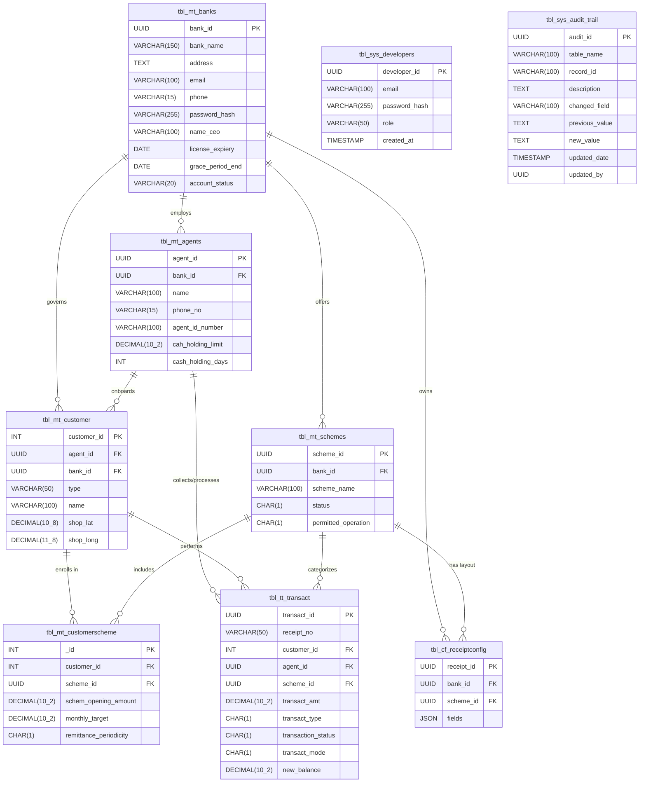

# Entity-Relationship (ER) Diagram
## Daily Collection Management System v6.0

This diagram represents the relational database structure, foreign key mappings, and cardinalities for the system as defined in PRD v6.0.

