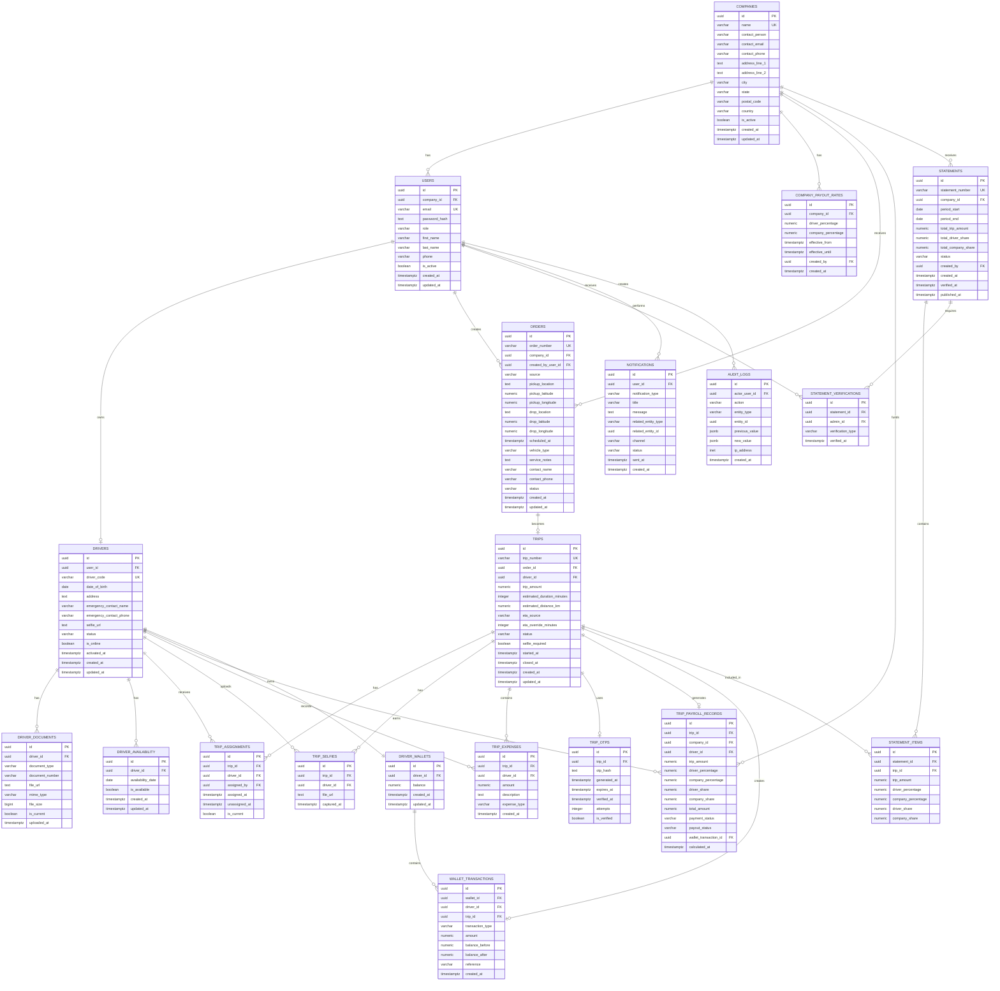

# HireD – Entity Relationship Diagram

## PostgreSQL Database ER Diagram

The following ER diagram represents the database structure documented in `database.md`.

## Core workflow

`Company → Order → Trip → Assignment → Expenses/OTP → Payroll → Wallet → Statement → Verification`

The diagram intentionally does not model a direct Company → Driver ownership relationship. Drivers are associated with trips/assignments, while payout rates are company-level.
