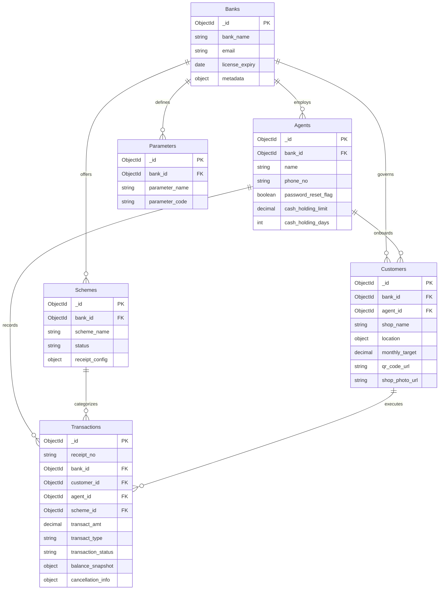

# MongoDB Schema Design & ER Model: Daily Collection Management System

Since MongoDB is a document-oriented NoSQL database, the schema design optimizes for **embedded documents** where relationships are 1-to-few, and **referenced documents (ObjectId references)** where relationships are 1-to-many or unbounded (e.g., transactions per customer or agent).

---

## 1. High-Level Entity Relationship Diagram (MongoDB Collections)



---

## 2. Visual Database Collection Schemas (JSON Format)

```json
// ==========================================
// 1. BANKS COLLECTION (Root Institution)
// ==========================================
{
  "_id": "ObjectId",
  "bank_name": "String",
  "address": "String",
  "email": "String",
  "phone": "String",
  "password_hash": "String",
  "name_ceo": "String",
  "designation": "String",
  "license_expiry": "ISODate",
  "audit_trail": {
    "created_at": "ISODate",
    "created_by": "ObjectId",
    "modified_at": "ISODate",
    "modified_by": "ObjectId"
  }
}

// ==========================================
// 2. AGENTS COLLECTION (Field Operators)
// ==========================================
{
  "_id": "ObjectId",
  "bank_id": "ObjectId (Ref: banks)",
  "name": "String",
  "address": "String",
  "phone_no": "String",
  "email": "String",
  "password_reset_flag": "Boolean",
  "last_password_change_date": "ISODate",
  "cash_holding_limit": "Decimal128",
  "cash_holding_days": "NumberInt",
  "audit_trail": {
    "created_at": "ISODate",
    "created_by": "ObjectId"
  }
}

// ==========================================
// 3. SCHEMES COLLECTION (With Embedded Config)
// ==========================================
{
  "_id": "ObjectId",
  "bank_id": "ObjectId (Ref: banks)",
  "scheme_name": "String",
  "scheme_description": "String",
  "status": "String ('A' or 'S')",
  "receipt_config": {
    "fields": [
      {
        "field_name": "String",
        "data_type": "String",
        "is_mandatory": "Boolean",
        "print_order": "NumberInt"
      }
    ]
  }
}

// ==========================================
// 4. CUSTOMERS COLLECTION (With GeoJSON)
// ==========================================
{
  "_id": "ObjectId",
  "agent_id": "ObjectId (Ref: agents)",
  "bank_id": "ObjectId (Ref: banks)",
  "type": "String",
  "name": "String",
  "address": "String",
  "phone": "String",
  "shop_name": "String",
  "location": {
    "type": "Point",
    "coordinates": [77.5946, 12.9716] // [Longitude, Latitude]
  },
  "monthly_target": "Decimal128",
  "qr_code_url": "String",
  "shop_photo_url": "String"
}

// ==========================================
// 5. TRANSACTIONS COLLECTION (Ledger)
// ==========================================
{
  "_id": "ObjectId",
  "receipt_no": "String",
  "bank_id": "ObjectId (Ref: banks)",
  "customer_id": "ObjectId (Ref: customers)",
  "agent_id": "ObjectId (Ref: agents)",
  "scheme_id": "ObjectId (Ref: schemes)",
  "transact_amt": "Decimal128",
  "transact_type": "String ('D' or 'W')",
  "transaction_status": "String ('A', 'C', or 'P')",
  "transact_mode": "String ('C' or 'T')",
  "balance_snapshot": {
    "opening_bal": "Decimal128",
    "new_balance": "Decimal128"
  },
  "cancellation_info": {
    "cancellation_reason": "String",
    "reviewed_by": "ObjectId (Ref: banks)"
  },
  "collect_date": "ISODate"
}
```

---

## 3. Recommended Performance Indexes
*   `customers`: `{ "bank_id": 1, "agent_id": 1 }` and a `2dsphere` index on `{ "location": "2dsphere" }` for spatial shop lookups.
*   `transactions`: `{ "customer_id": 1, "collect_date": -1 }` and `{ "agent_id": 1, "transaction_status": 1 }`.
*   `agents`: `{ "phone_no": 1 }` (Unique constraint for mobile app logins).